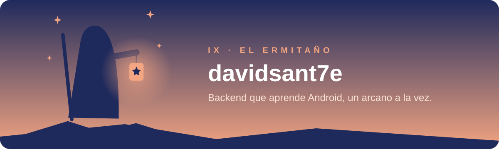
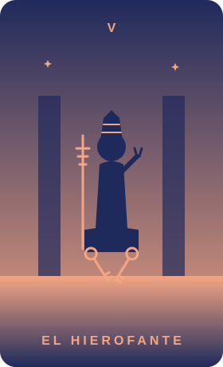
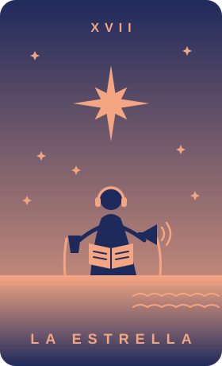
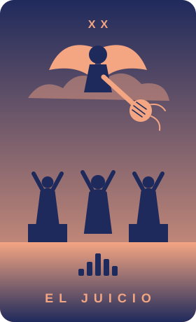
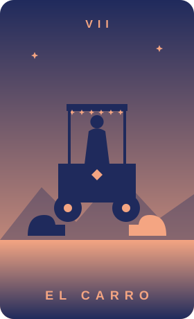
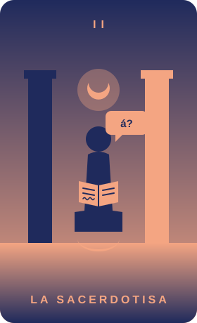
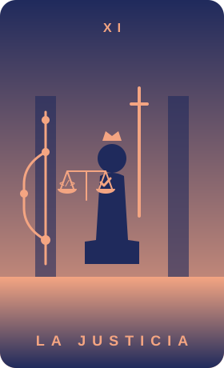

  

Soy desarrollador **backend** y estoy aprendiendo **Android**. Cada proyecto que empiezo tiene su carta de los Arcanos Mayores: la carta principal es la plataforma original y las versiones para otras plataformas son ramas de la misma carta.

## 🃏 El mazo

<table>
  <tr>
    <td align="center" width="20%">
       
      <b><a href="https://github.com/davidsant7e/codelock-android">CodeLock</a></b> 
      Una pregunta de programación cada vez que desbloqueas el celular. 
      <code>Android</code> · <code>Kotlin</code> · <code>Compose</code> 
      Rama Windows: <a href="https://github.com/davidsant7e/codelock-windows">codelock-windows</a>
    </td>
    <td align="center" width="20%">
       
      <b>AudioNovel</b> 
      Traduce novelas ligeras y las convierte en audio para escucharlas en el celular. 
      <code>Python</code> · <code>FastAPI</code> · <code>Android</code> 
      <i>Repositorio privado</i>
    </td>
    <td align="center" width="20%">
       
      <b><a href="https://github.com/davidsant7e/miccheck-android">MicCheck</a></b> 
      Diagnostica el micrófono del celular y sugiere qué hacer si falla. 
      <code>Android</code> · <code>Kotlin</code> · <code>AudioRecord</code>
    </td>
    <td align="center" width="20%">
       
      <b><a href="https://github.com/davidsant7e/girar-pantalla">GirarPantalla</a></b> 
      Gira la pantalla de Windows con un atajo de teclado. 
      <code>Windows</code> · <code>PowerShell</code> · <code>C#</code>
    </td>
    <td align="center" width="20%">
       
      <b>Rutas alternativas</b> 
      Más de cinco rutas a un destino, incluidas las vías poco usadas. 
      <i>En exploración</i>
    </td>
  </tr>
  <tr>
    <td align="center" width="20%">
       
      <b><a href="https://github.com/davidsant7e/sacerdotisa">La Sacerdotisa</a></b> 
      Corrector que explica el porqué de cada error: mayúsculas, tildes, palabras que se confunden. 
      <code>Extensión</code> · <code>Windows</code> · <code>Android</code> · <code>LanguageTool</code>
    </td>
    <td align="center" width="20%">
       
      <b><a href="https://github.com/davidsant7e/justicia">La Justicia</a></b> 
      Revisa lo que vas a commitear (claves, archivos sensibles, depuración) y sugiere el mensaje. 
      <code>VS Code</code> · <code>Kiro</code> · <code>Visual Studio</code> · <code>Gemini</code>
    </td>
  </tr>
</table>

## 🛠️ Con qué trabajo

`C#` · `.NET` · `Java` · `Spring Boot` · `Kotlin` · `Jetpack Compose` · `Android` · `Python` · `FastAPI` · `SQLite` · `PowerShell` · `Docker` · `Git`

## 🔭 Ahora mismo

- Aprendiendo Android con proyectos reales, del primer `Hello Android` al celular.
- CodeLock ya corre en Windows; sigue el reloj.

Ilustraciones propias en estilo duotono · azul noche <code>#1f2a5c</code> y durazno <code>#f4a582</code>

